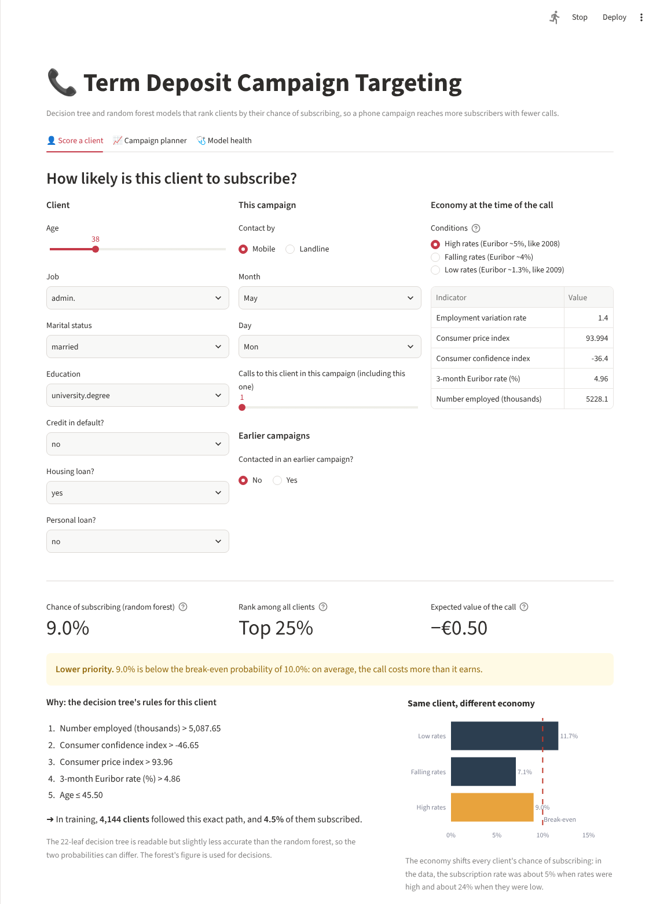
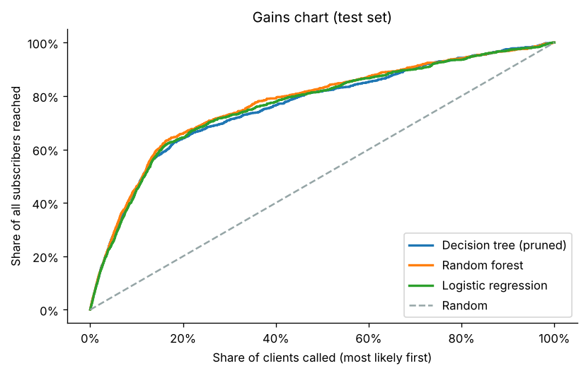
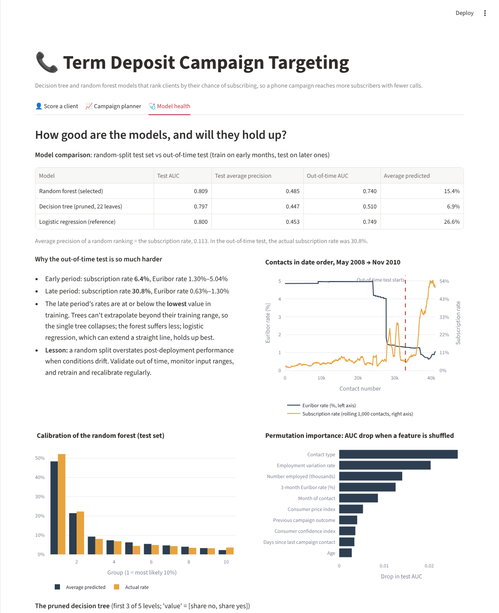
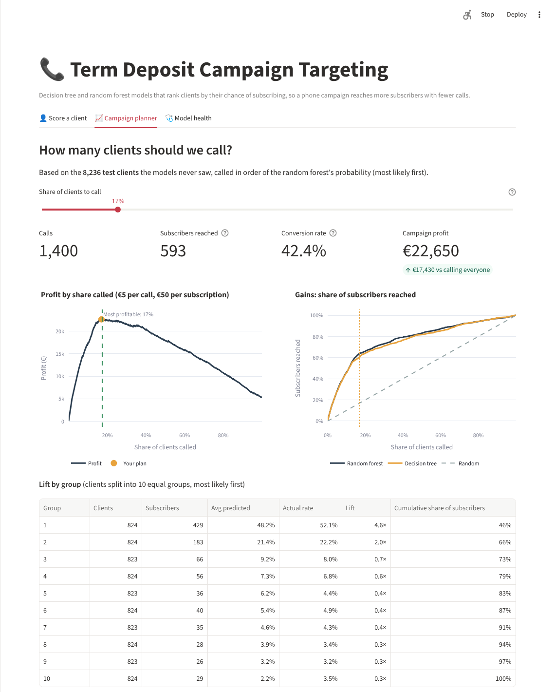

# Term Deposit Marketing: Decision Trees and Random Forests

Ranking bank clients by their chance of subscribing to a term deposit, so a phone campaign reaches more subscribers with fewer calls. A **pruned decision tree** gives readable rules; a **random forest** gives the best ranking; an **out-of-time test** shows what happens when the economy shifts after training. Delivered through an **interactive Streamlit dashboard**.

**▶ Live dashboard: [YOUR-APP-URL](https://term-deposit-targeting.streamlit.app/)** · [Notebook](notebooks/term_deposit_decision_tree_random_forest.ipynb) · [Deployment guide](DEPLOY.md)



## Business problem

Outbound sales calls are expensive and most clients say no: only about 1 in 9 subscribed in this data. Ranking clients by their predicted chance of subscribing lets the bank call the most promising clients first and decide how many calls are worth making, given the cost of a call and the value of a new deposit.

## Data

[Bank Marketing](https://archive.ics.uci.edu/dataset/222/bank+marketing) (UCI Machine Learning Repository; Moro, Cortez & Rita, 2014), the `bank-additional-full` version: 41,188 phone contacts by a Portuguese bank, May 2008 to November 2010. It includes client details, campaign history and five economic indicators at the time of each call. Subscription rate 11.3%.

## Approach

1. **Data quality:** 12 duplicate rows removed; `unknown` kept as its own category; `pdays = 999` ("never contacted") recoded to −1.
2. **Leakage removed:** `duration` (call length) is only known after the call. With it, a decision tree scores AUC 0.94; without it, 0.80. It is dropped.
3. **Decision tree:** Gini impurity worked by hand for the root split. An unrestricted tree memorises the data (4,981 leaves; training AUC 1.00, test 0.63). It is tuned with 5-fold cross-validation over depth and minimum leaf size, then the **one-standard-error rule** picks the simplest good tree: **depth 5, 22 leaves**.
4. **Random forest:** 300 trees on bootstrap samples, with random feature subsets at each split; leaf size tuned by cross-validation; out-of-bag AUC 0.797.
5. **Evaluation:** AUC, average precision (more informative at an 11% base rate), gains and lift, and calibration by decile.
6. **Feature importance:** impurity importance compared with permutation importance, and why they disagree.
7. **Campaign economics:** a profit curve from an illustrative cost per call and value per subscription; break-even probability = cost ÷ value.
8. **Out-of-time validation:** train on the first 80% of contacts (chronological), test on the last 20%.

## Results (random 20% test set, 8,236 clients)

| Model | Test AUC | Average precision | Out-of-time AUC |
|---|---|---|---|
| **Random forest (selected)** | **0.809** | **0.485** | 0.740 |
| Decision tree (pruned, 22 leaves) | 0.797 | 0.447 | 0.510 |
| Logistic regression (reference) | 0.800 | 0.453 | 0.749 |

- **Top 10% of clients** (by the forest's score): 52% subscribe, a **lift of 4.6×**, reaching 46% of all subscribers. The top 20% reaches two thirds.
- **At €5 per call and €50 per subscription** (illustrative): calling the top 17% earns **€22,695** on the test set, more than four times the €5,220 from calling everyone, while still reaching 64% of subscribers.
- **The 22-leaf tree is nearly as good as the forest** on a random split, and every one of its rules can be read and challenged.



## Key findings

- **Out-of-time validation changes the story.** The late period had a 31% subscription rate (vs 6% earlier), and Euribor rates at or below the lowest value seen in training. Trees can't extrapolate beyond their training range: the single tree collapses to AUC 0.51, the forest holds 0.74, and logistic regression, which can extend a straight line, does narrowly best. **A random-split score overstates post-deployment performance when conditions drift.**
- **The economy dominates.** The tree's first split is on employment, and the economic indicators take most of the impurity importance. They set the baseline for every client called on a given day.
- **Impurity vs permutation importance disagree, for known reasons.** Contact type (mobile vs landline) ranks low on impurity, since a yes/no feature offers one split, but highest on permutation. Correlated features (the economic indicators; `pdays`, `poutcome` and `previous`) share credit.
- **The forest's probabilities are compressed:** good for ranking, but they'd need calibration before being used as forecasts.



## Interactive dashboard

| Tab | What it does |
|---|---|
| **Score a client** | Enter a client's details, campaign history and economic conditions. Get the forest's probability, the client's rank, the expected value of the call and a call / lower-priority decision, plus **the decision tree's rules for that client** and how the same client scores under different economies |
| **Campaign planner** | Set the cost per call and value per subscription (sidebar) and the share of clients to call. See calls, subscribers reached, conversion and profit, the profit curve, the gains chart and the lift table |
| **Model health** | Random-split vs out-of-time comparison, the Euribor and subscription-rate history, calibration, permutation importance, and the pruned tree |

<details>
<summary>Campaign planner screenshot</summary>



</details>

## Limitations

- One bank in Portugal, 2008–2010, including the financial crisis: the method transfers, the numbers don't.
- The economic indicators set the baseline more than they separate clients called on the same day.
- The cost and value figures are illustrative; real ones would come from finance.
- Selection bias: the bank chose whom to call, so the data only covers clients it decided to contact.

## Model ownership

If this were deployed, I'd maintain a model card, run an out-of-time test on the most recent months before every release, monitor conversion by score group and input ranges (especially the economic indicators) each campaign, and retrain and recalibrate when inputs leave the training range or lift in the top group falls. Age is a model input, so I'd confirm that targeting by age is permitted for the product and review outcomes by age band. The automated tests in `tests/` check that the dashboard reproduces the notebook's results.

## Project structure

```
├── app.py                      # Streamlit dashboard
├── src/marketing_model.py      # Model code shared by the dashboard (mirrors the notebook)
├── notebooks/
│   └── term_deposit_decision_tree_random_forest.ipynb   # Full analysis, commented step by step
├── tests/test_app.py           # Automated checks for the models and the dashboard
├── data/bank-additional-full.csv
├── reports/figures/            # Charts and dashboard screenshots
├── requirements.txt            # Packages for the dashboard (used by Streamlit Cloud)
├── requirements-dev.txt        # Adds notebook and test packages, for local work
└── DEPLOY.md                   # Step-by-step: run locally, push to GitHub, deploy
```

## How to run

```bash
git clone https://github.com/DataKritii/term-deposit-marketing-decision-tree.git
cd term-deposit-marketing-decision-tree
pip install -r requirements-dev.txt

streamlit run app.py          # the dashboard, at http://localhost:8501
jupyter notebook              # the analysis notebook
pytest tests/                 # the automated tests
```

## Tech stack

Python · pandas · scikit-learn · Streamlit · Plotly · matplotlib · pytest
